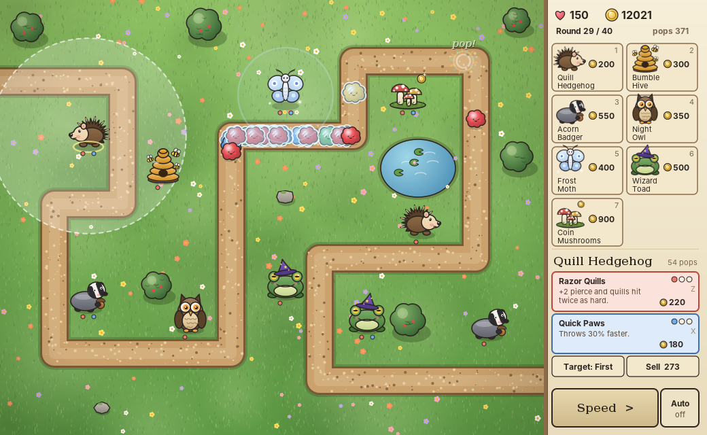
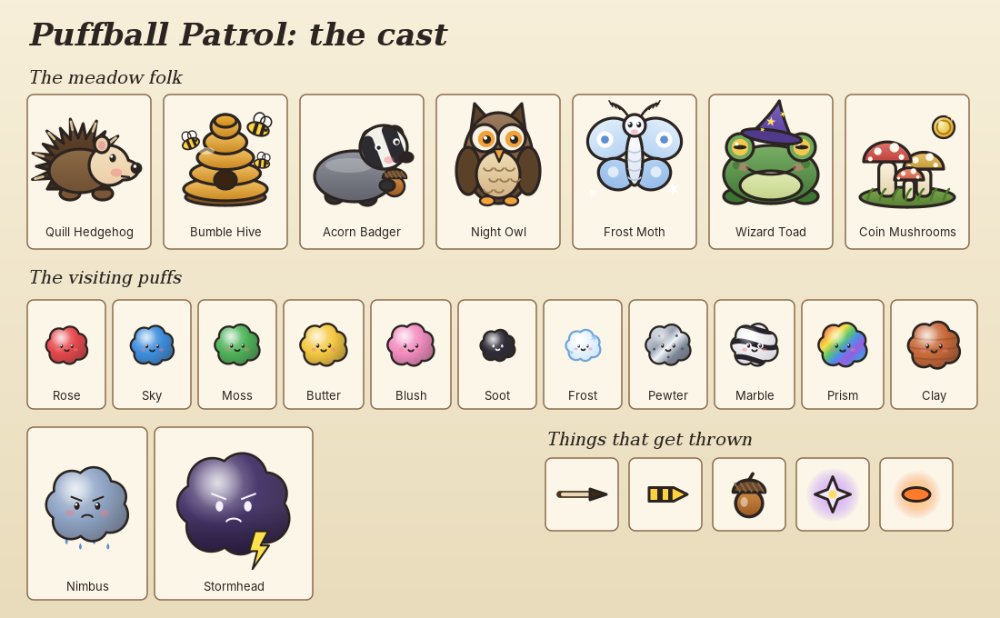

# Puffball Patrol

*In which the meadow creatures politely decline a visit from the clouds.*

An original balloon-popping tower-defense game in plain Java (Swing + Java2D). Every sprite, puff
and map is painted in code by [`Art.java`](src/main/java/puffpatrol/Art.java): the game ships with
no image files at all.



## Running it

You need JDK 17 or newer.

```bash
./run.sh            # macOS / Linux (run.bat on Windows)
```

Or build a runnable jar with Maven:

```bash
mvn package
java -jar target/puffball-patrol.jar
```

## How to play

Puffs drift along the path. Each one that slips through costs lives equal to everything hidden
inside it. Place critters beside the path to pop them. Every layer popped drops a coin, and every
round cleared pays a bonus. Survive 40 rounds to win, then carry on in freeplay for as long as the
meadow holds.

| Key | Action |
| --- | --- |
| Space | Start the next round / toggle fast-forward |
| 1–7 | Pick a critter from the shop |
| Click / Shift-click | Place one / place several |
| Z / X | Buy the next upgrade on path A / path B |
| Tab | Cycle targeting (First, Last, Strong, Close) |
| Delete | Sell the selected critter (70% refund) |
| A | Toggle auto-start of rounds |
| Esc / right-click | Cancel |

Each critter has two upgrade paths of three tiers. Only one path can reach tier 3; the other then
stops at tier 2.

### The meadow folk

| Critter | Cost | What it does |
| --- | --- | --- |
| Quill Hedgehog | 200 | Throws sharp quills that pierce several puffs |
| Bumble Hive | 300 | Sends stingers out in every direction |
| Acorn Badger | 550 | Lobs exploding acorns for area damage |
| Night Owl | 350 | Swoops on any puff anywhere on the map |
| Frost Moth | 400 | Freezes nearby puffs in place |
| Wizard Toad | 500 | Magic bolts that pop anything |
| Coin Mushrooms | 900 | Grows coins at the end of every round |

### The visiting puffs

Rose → Sky → Moss → Butter → Blush, each one hiding the one before. Then come the troublemakers:

- **Soot** shrugs off explosions.
- **Frost** can't be frozen.
- **Pewter** is too tough for anything sharp.
- **Marble** resists both explosions and cold.
- **Prism** splits into two Marbles.
- **Clay** takes ten hits per layer.
- **Nimbus** and **Stormhead** are big grumpy clouds that only get slowed by frost.



## The art

All the art is generated. To write every sprite out as a PNG (at 2× resolution):

```bash
java -jar target/puffball-patrol.jar --export-art art
```

The [`art/`](art) folder holds the current export: towers, puffs, projectiles, both map
backgrounds and a contact sheet.

## Code tour

| File | Role |
| --- | --- |
| `Main.java` | Opens the window |
| `GamePanel.java` | Rendering, sidebar UI, mouse and keyboard |
| `World.java` | Game rules: spawning, damage, money, rounds |
| `Tower.java`, `TowerType.java`, `Upgrade.java` | Critters, their stats and upgrade paths |
| `Puff.java`, `PuffType.java` | Puffs, their layers and immunities |
| `Projectile.java`, `Particle.java` | Things in flight and visual effects |
| `GameMap.java`, `Maps.java` | Paths, scenery and where you can build |
| `Waves.java` | The 40 hand-written rounds plus the freeplay generator |
| `Art.java`, `ArtExporter.java` | Procedural art and PNG export |
