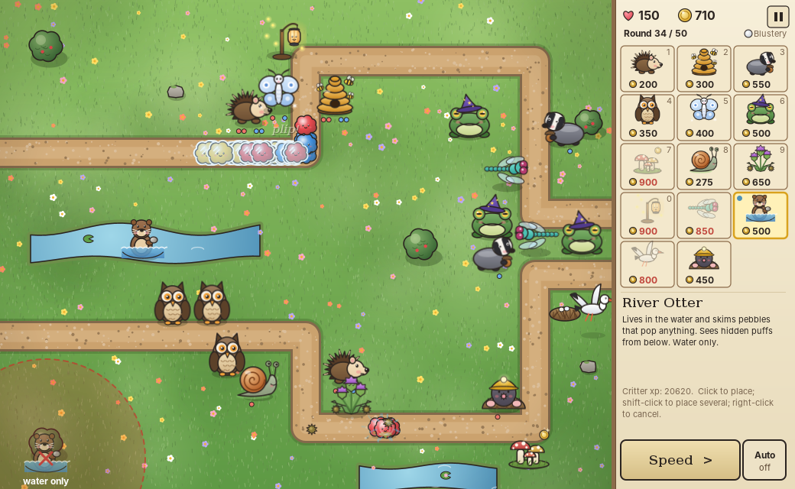
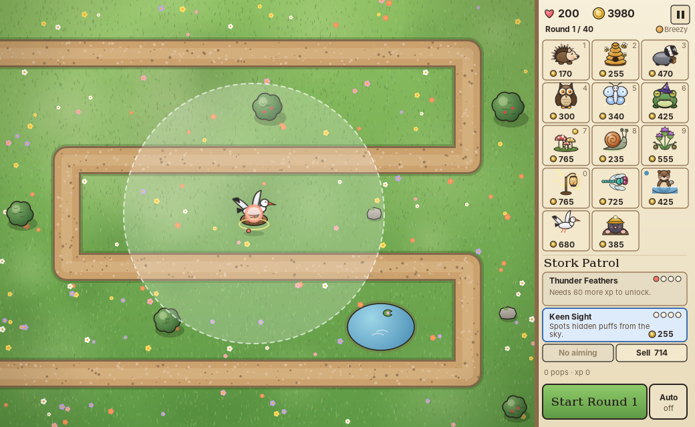

# Puffball Patrol

*In which the meadow creatures politely decline a visit from the clouds.*

An original balloon-popping tower-defense game in plain Java (Swing + Java2D). Every critter, puff,
map and sound effect is made in code by [`Art.java`](src/main/java/puffpatrol/Art.java) and
[`Sound.java`](src/main/java/puffpatrol/Sound.java): the game ships with no image or audio files.



## Running it

You need JDK 17 or newer.

```bash
./run.sh            # macOS / Linux (run.bat on Windows)
```

Or build a runnable jar with Maven:

```bash
mvn package
java -jar target/puffball-patrol.jar
```

## How to play

Pick a difficulty and a map on the title page. Puffs drift along the path, and each one that slips
through costs lives equal to every layer hidden inside it. Place critters beside the path to pop
them. Each layer popped drops a coin and each round cleared pays a bonus. Reach the final round to
earn that difficulty's medal on that map, then carry on in freeplay.

| Key | Action |
| --- | --- |
| Space | Start the next round / change speed (1x, 2x, 3x) |
| 1–9, 0 | Pick one of the first ten critters from the shop |
| Click / Shift-click | Place one / place several |
| Z / X | Buy the next upgrade on path A / path B |
| Q W E R T Y U | Use an activated ability (also clickable in the bar at bottom-left) |
| Tab | Cycle targeting (First, Last, Strong, Close) |
| Delete | Sell the selected critter (70% refund) |
| A | Toggle auto-start of rounds |
| P or Esc | Pause menu (speed, sound, unlocks, restart, save and quit) |
| M | Mute |

### Difficulties

| Difficulty | Lives | Prices | Rounds |
| --- | --- | --- | --- |
| Breezy | 200 | 15% cheaper, slower puffs | 1–40 |
| Blustery | 150 | normal | 1–50 |
| Stormy | 100 | 8% dearer, faster puffs | 3–60 |
| Tempest | 1 | 20% dearer, faster puffs | 6–70 |

### Upgrades and abilities

Every critter has two upgrade paths of four tiers. Only one path can go past tier 2. Upgrades are
unlocked with **critter xp**, which each kind of critter earns at the end of every round you play
with it, so later upgrades open up as you keep using a critter. To skip this, switch
**Upgrades: all unlocked** on the title page or in the pause menu.

Upgrades marked ★ grant an **activated ability**, such as Deep Winter (freeze the whole map), Tidal
Wave or Pinecone Barrage. Abilities appear in the bar at the bottom-left of the map and recharge
after use.



### The meadow folk

| Critter | Cost | What it does |
| --- | --- | --- |
| Quill Hedgehog | 200 | Throws sharp quills that pierce several puffs |
| Bumble Hive | 300 | Sends stingers out in every direction |
| Acorn Badger | 550 | Lobs exploding acorns for area damage |
| Night Owl | 350 | Swoops on the strongest puff anywhere on the map |
| Frost Moth | 400 | Freezes nearby puffs in place |
| Wizard Toad | 500 | Magic bolts that pop anything |
| Coin Mushrooms | 900 | Grows coins at the end of every round |
| Slime Snail | 275 | Slime slows puffs; later slime dissolves them |
| Thistle Patch | 650 | Drops spiky burrs onto the path |
| Firefly Lantern | 900 | Support: boosts critters in its glow and lets them see hidden puffs |
| Dragonfly Gunner | 850 | A rapid stream of barbs, later lasers or exploding seeds |
| River Otter | 500 | **Water only.** Skims pebbles that pop anything; sees hidden puffs |
| Stork Patrol | 800 | Circles its nest, scattering feathers in every direction |
| Mole Burrower | 450 | Pops up under nearby puffs and stops them in their tracks |

### The visiting puffs

Rose → Sky → Moss → Butter → Blush, each one hiding the one before. Then come the troublemakers:

- **Soot** shrugs off explosions.
- **Frost** can't be frozen.
- **Pewter** is too tough for anything sharp.
- **Marble** resists both explosions and cold.
- **Prism** splits into two Marbles.
- **Clay** takes ten hits per layer.
- **Nimbus** and **Stormhead** are big grumpy clouds that only get slowed by frost.

Puffs can also carry **traits**:

- **Hidden** (faded, dotted outline): only critters that can spot them will aim at them, though
  explosions and area attacks still hit.
- **Regrowing** (little sprout): grow back a layer if left alone for a few seconds.
- **Armoured** (metal band): tough layers take twice as many hits.


### Maps

| Map | Level | Notes |
| --- | --- | --- |
| Willow Meadow | Beginner | Winding track past a pond |
| Clover Hill | Beginner | Long switchbacks, lots of room |
| Lighthouse Isle | Intermediate | Spiral up the island; sea on the shore |
| Millpond | Intermediate | Path circles a big pond: otter country |
| Mushroom Hollow | Intermediate | Zigzag through dark woods |
| Twin Brooks | Advanced | Two paths at once (extra starting coins) |
| Windmill Crossing | Advanced | The path crosses itself |
| Thundercliff | Expert | Short path, ravines, little room to build |

## Saving

The game autosaves after every round and you can **Continue** from the title page. Critter xp,
medals and settings are kept in `~/.puffpatrol/`.

## The art

All the art is generated. To write every sprite out as a PNG (at 2× resolution):

```bash
java -jar target/puffball-patrol.jar --export-art art
```

The [`art/`](art) folder holds the current export: critters, puffs, projectiles, all eight map
backgrounds and a contact sheet.

## Code tour

| File | Role |
| --- | --- |
| `Main.java` | Opens the window |
| `GamePanel.java` | Title page, rendering, sidebar, ability bar, pause menu, input |
| `World.java` | Game rules: spawning, damage, traits, buffs, abilities, rounds |
| `Tower.java`, `TowerType.java`, `Upgrade.java`, `Ability.java` | Critters, stats, upgrade paths and abilities |
| `Puff.java`, `PuffType.java` | Puffs, layers, immunities and traits |
| `Projectile.java`, `Particle.java` | Things in flight and visual effects |
| `GameMap.java`, `Maps.java` | Paths, water, scenery and where you can build |
| `Waves.java` | The 70 hand-written rounds plus the freeplay generator |
| `Difficulty.java` | Lives, prices, speed and length for each difficulty |
| `Profile.java`, `SaveGame.java` | Critter xp, medals, settings and the save slot |
| `Sound.java` | Synthesised sound effects |
| `Art.java`, `ArtExporter.java` | Procedural art and PNG export |

## Bloons reference data script

[`scripts/fetch_bloons_data.rb`](scripts/fetch_bloons_data.rb) pulls reference names from the
[Bloons Wiki](https://bloons.fandom.com) API: BTD5 towers and their upgrade paths, BTD5 maps (with
difficulty), BTD6 difficulties and modes, BTD6 Bloons and BTD6 Boss Bloons. It uses only the Ruby
standard library.

```bash
ruby scripts/fetch_bloons_data.rb                          # readable summary
ruby scripts/fetch_bloons_data.rb --json data/bloons_data.json
ruby scripts/fetch_bloons_data.rb --json - | jq .btd6.bosses
```

A snapshot of its output is in [`data/bloons_data.json`](data/bloons_data.json). The wiki's content
is licensed CC BY-SA.
